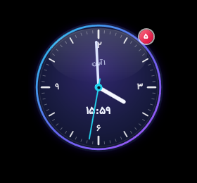
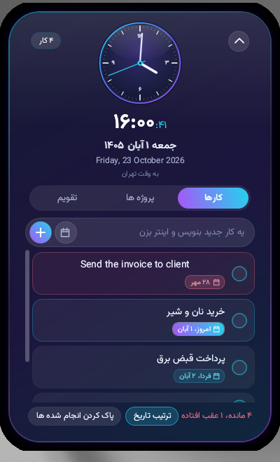
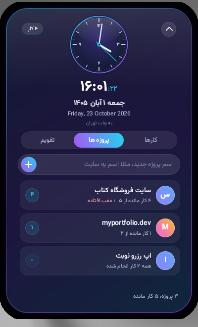
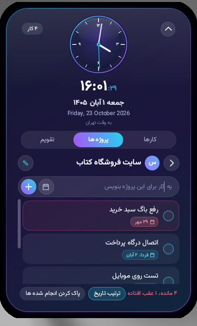
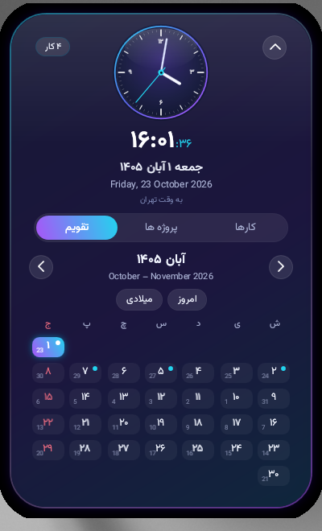

<div dir="rtl">

# TodoClock

ویجت بومی ویندوز برای ساعت، کارهای روزانه و پروژه ها. ساعت دایره ای و نیمه شفاف است، همیشه روی بقیه پنجره ها می ماند، و با موس جابجا میشود. وقت تهران را نشان میدهد و کنار آن تاریخ شمسی و میلادی، فهرست کارهای روزانه، پروژه ها با فهرست کار خودشان، تاریخ انجام، و نمای تقویم قرار دارد.

برنامه با سی شارپ و WPF روی دات نت ۸ نوشته شده. فونت وزیرمتن (Vazirmatn) با مجوز OFL همراه سورس است. متن مجوز در `docs/OFL-Vazirmatn.txt` و `src/Fonts/OFL.txt` است.

## ویژگی ها

- ساعت تهران با صفحه دایره ای، عقربه، و نمایش ساعت و دقیقه و ثانیه
- تاریخ شمسی و تاریخ میلادی
- کارهای روزانه؛ کار امروز با رنگ اصلی و کار عقب افتاده به رنگ قرمز
- پروژه ها، هر کدام با فهرست کار جدا، تغییر نام، و شمارش کارهای مانده
- تاریخ انجام برای هر کار: امروز، فردا، هفته بعد، یا یک روز از تقویم شمسی؛ بدون تاریخ هم میتوان انتخاب کرد
- تقویم شمسی و میلادی؛ روزهای دارای کار نقطه دارند و اگر کاری عقب افتاده باشد آن روز قرمز است
- پنجره همیشه بالا و بیرون از فهرست Alt+Tab
- اجرا همراه روشن شدن ویندوز
- آیکون در سینی سیستم، کنار ساعت ویندوز

## نماها

تصویرها نمای ویجت با داده نمونه هستند.

### ساعت جمع شده

در این حالت فقط ساعت دیده میشود. نشان گوشه، تعداد کارهای مانده امروز است و اگر کاری عقب افتاده باشد قرمز میشود.



### کارهای روزانه

با باز شدن پنل، تب کارها فهرست روزانه را نشان میدهد. تاریخ شمسی و میلادی زیر ساعت نوشته شده است.



### پروژه ها

هر کارت نام پروژه و تعداد کارهای مانده را نشان میدهد. کلیک روی کارت، فهرست کار همان پروژه را باز میکند.





### تقویم

روزهای ماه، روز جاری، و روزهایی که کار دارند روی تقویم مشخص است.



تصویرهای دیگر در پوشه `screenshots/` است: `day-panel.png` برای کارهای یک روز، `due-picker.png` برای انتخاب تاریخ انجام، و `animation-frame.png` برای حالت میانی باز شدن پنل.

## استفاده

- کشیدن با موس: ویجت را به هر جای صفحه ببر
- دو بار کلیک روی ساعت، یا دکمه کوچک پایین آن: پنل را باز یا جمع کن
- دکمه بالای پنل، یا کلید Esc: جمع کردن
- چرخ موس روی ساعت: شفافیت را کم یا زیاد کن
- کلیک راست روی ویجت: منو، با این گزینه ها: باز کردن یا جمع کردن، شفافیت پیش فرض، اجرا با روشن شدن ویندوز، پنهان کردن، و خروج
- آیکون سینی: نمایش یا پنهان، باز و جمع کردن، اجرا با روشن شدن ویندوز، و خروج. کلیک چپ روی آیکون هم ویجت را نشان میدهد یا پنهان میکند

عدد روی ساعت جمع شده تعداد کارهای مانده امروز است.

داده ها در `%APPDATA%\TodoClock` ذخیره میشود و فایل اصلی `data.json` است. راهنمای کامل تر در `docs/README.txt` است.

## اجرا

بسته آماده در `release/TodoClock-app.zip` این دو فایل را دارد:

- `TodoClock.exe`
- `README.txt`

این ساخت به ران تایم وابسته است و برای اجرا به [.NET 8 Desktop Runtime نسخه ویندوز x64](https://dotnet.microsoft.com/download/dotnet/8.0) نیاز دارد. اگر ران تایم نصب نباشد، خود برنامه موقع اجرا لینک دانلود را نشان میدهد.

## ساخت

این پروژه روی لینوکس ساخته شده و در `src/TodoClock.csproj` گزینه `EnableWindowsTargeting` روشن است تا انتشار برای ویندوز از روی لینوکس ممکن باشد.

نسخه سبک و وابسته به ران تایم. خروجی کوچک است و روی ویندوز به .NET 8 Desktop Runtime نیاز دارد:

</div>

```bash
dotnet publish src/TodoClock.csproj -c Release -r win-x64 --self-contained false
```

<div dir="rtl">

نسخه مستقل، یک فایل اجرایی حدود ۶۳ مگابایت که ران تایم را همراه دارد:

</div>

```bash
dotnet publish src/TodoClock.csproj -c Release -r win-x64 --self-contained true -p:PublishSingleFile=true -p:IncludeNativeLibrariesForSelfExtract=true -p:EnableCompressionInSingleFile=true
```

<div dir="rtl">

خروجی هر دو دستور زیر `src/bin/Release/net8.0-windows/win-x64/` قرار میگیرد. پوشه های `bin/` و `obj/` در مخزن نیستند.

</div>
